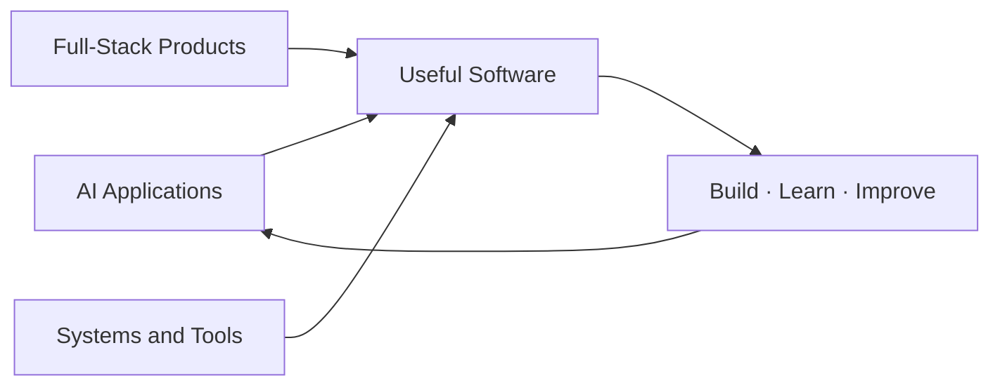

  

 

## 🧠 Areas I Explore

## ⚙️ Build Loop

`💡 Idea` &nbsp; → &nbsp; `🧩 Prototype` &nbsp; → &nbsp; `🧪 Test and refine` &nbsp; → &nbsp; `🚀 Share`

## 🧰 Tools & Topics

**Languages and frameworks** 

**Project themes** 
Semantic search · Knowledge graphs · Document processing · Offline-first apps

## 🌆 Contribution Skyline

  

## 📊 Live Stats

 

 

## 🚀 Featured Projects

 

## 🐍 The Snake Is Eating My Commits

<picture>
  <source media="(prefers-color-scheme: dark)" srcset="https://raw.githubusercontent.com/dhruv11bhandari/dhruv11bhandari/output/github-snake-dark.svg" />
  <source media="(prefers-color-scheme: light)" srcset="https://raw.githubusercontent.com/dhruv11bhandari/dhruv11bhandari/output/github-snake.svg" />
  
</picture>

## 🎮 Click Around

<b>🏆 GitHub Trophy Case</b>

 

<b>🤝 Let's Build Something Together</b>

 

- 🧠 AI and data-focused projects
- ⚡ Hackathons and build sprints
- 🛠️ Open-source developer tools
- 💬 Systems, algorithms, and product ideas

📬 [Connect on LinkedIn](https://www.linkedin.com/in/dhruv-bhandari-b08041364/) or open an issue on one of my repositories.

<b>💬 Dev Quote of the Moment</b>

 

 

