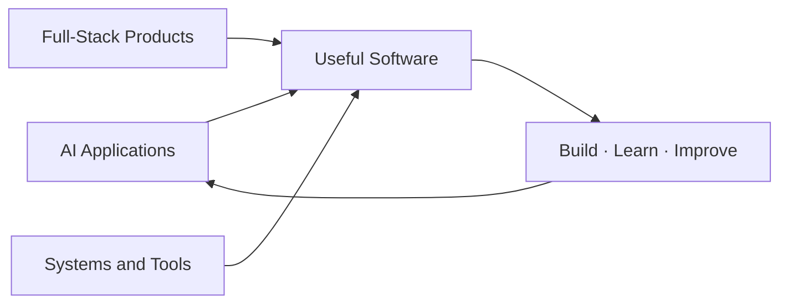
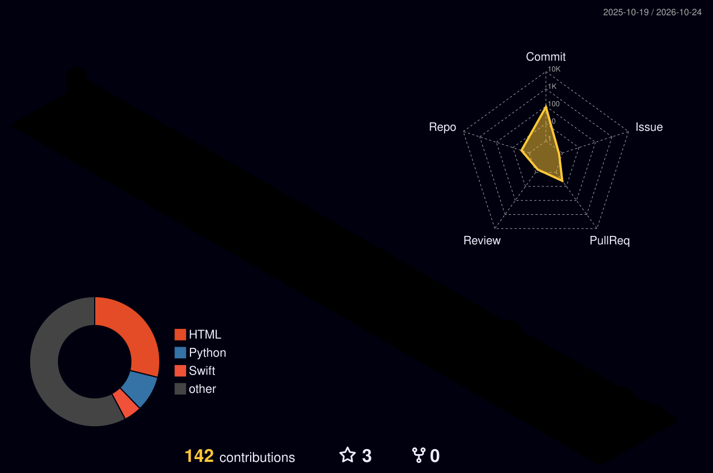

  

 

## 🧠 Areas I Explore

## ⚙️ Build Loop

`💡 Idea` &nbsp; → &nbsp; `🧩 Prototype` &nbsp; → &nbsp; `🧪 Test and refine` &nbsp; → &nbsp; `🚀 Share`

## 🧰 Tools & Topics

**Languages and frameworks** 

<h3 align="left"> Languages and Tools:</h3>

<table align="center">
  <tr>
    <td align="center" width="96">
        
       React
    </td>
    <td align="center" width="96">
        
       Python
    </td>
    <td align="center" width="96">
        
       JavaScript
    </td>
    <td align="center" width="96">
        
       C++
    </td>
    <td align="center" width="96">
        
       Webpack
    </td>
    <td align="center" width="96">
        
       Django
    </td>
    <td align="center" width="96">
        
       TypeScript
    </td>
    <td align="center" width="96">
        
       AWS
    </td>
    <td align="center" width="96">
        
       C#
    </td>
  </tr>
  <tr>
    <td align="center" width="96">
        
       PHP
    </td>
    <td align="center" width="96">
        
       GitHub
    </td>
    <td align="center" width="96">
        
       Git
    </td>
    <td align="center" width="96">
        
       Laravel
    </td>
    <td align="center" width="96">
        
       HTML5
    </td>
    <td align="center" width="96">
        
       CSS
    </td>
    <td align="center" width="96">
        
       Bootstrap
    </td>
    <td align="center" width="96">
        
       Tailwind
    </td>
    <td align="center" width="96">
        
       jQuery
    </td>
  </tr>
 <tr>
      <td align="center" width="96">
        
       MongoDB
    </td>
    <td align="center" width="96">
        
       Nodejs
    </td>
    <td align="center" width="96">
        
       MySQL
    </td>
    <td align="center" width="96">
        
       VsCode
    </td>
    <td align="center" width="96">
        
       WordPress
    </td>
    <td align="center" width="96">
        
       Vue
    </td>
    <td align="center" width="96">
        
       Sass
    </td>
    <td align="center" width="96">
        
       GraphQL
    </td>
    <td align="center" width="96">
        
       PostgreSQL
    </td>
  </tr>
</table>

## 🌆 Contribution Skyline

  

## 📊 Live Stats

 

 

## 🚀 Featured Projects

 

📬 [Connect on LinkedIn](https://www.linkedin.com/in/dhruv-bhandari-b08041364/) or open an issue on one of my repositories.

 

